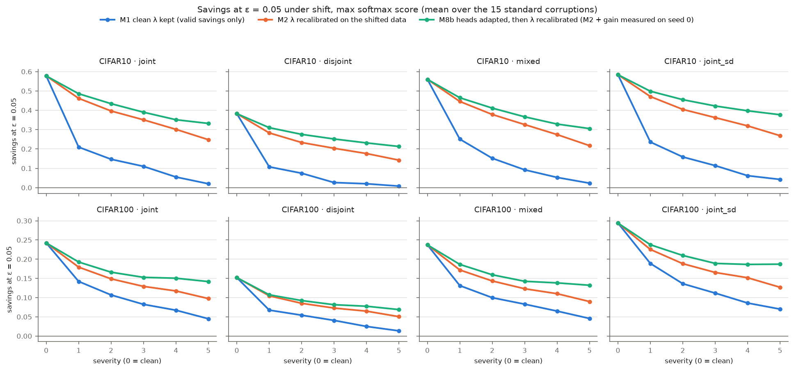
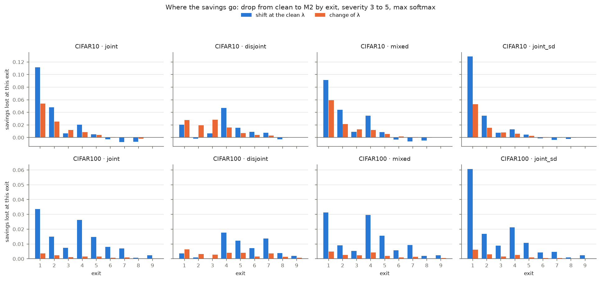
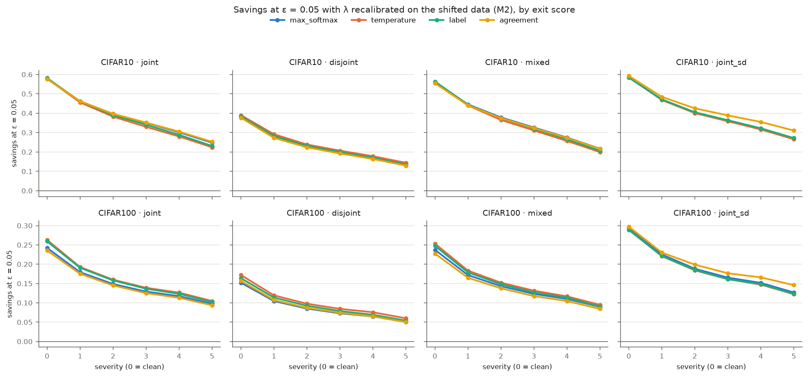

# Compute savings of early exit networks under distribution shift

Neural Networks project (Sapienza, prof. Scardapane).

We study how the compute savings of an early exit network change under distribution shift
when its label-free risk control (Fast yet Safe, Jazbec et al., NeurIPS 2024) must stay valid,
and how much of those savings an adaptation phase of the exit heads can recover, net of its cost.
The full plan is in the project document "Compute savings degli early exit sotto shift"
(https://claude.ai/artifact/MNreFiy1XTNWcYZcUC8axi).

Block 1 sets up the code and reproduces Fast yet Safe on its released ImageNet logits.
Block 2 trains a multi exit ResNet20 on CIFAR10 and CIFAR100 with four training regimes and saves
its outputs on the clean test set and on CIFAR-10-C / CIFAR-100-C, for the analysis of the savings under shift.
Block 3 measures how the savings change under shift at a fixed risk level, and how much an offline
adaptation of the heads recovers (week 4 of the project document).

## Setup

```bash
conda env create -f environment.yml
conda activate eesavings
```

The reference repositories go in `third_party/` (not tracked by git):

```bash
# Fast yet Safe (Jazbec et al. 2024)
git clone https://github.com/metodj/RC-EENN.git third_party/RC-EENN
git -C third_party/RC-EENN checkout 3db9a52
# Pomponi et al. 2022, base for our multi exit networks
git clone https://github.com/jaryP/ConfidenceBranchNetwok.git third_party/ConfidenceBranchNetwok
git -C third_party/ConfidenceBranchNetwok checkout 405d273
```

## Code

- `src/eesavings/risk/`: exit rule, losses, bounds and threshold calibration, copied from Fast yet Safe with the same function names,
  plus our `rc_main_fast` (same results as `rc_main`, but faster), which the script uses.
- `src/eesavings/fys.py`: losses and exits for every threshold of the grid, from the logits of all exits.
- `src/eesavings/savings.py`: compute savings and their decomposition over the exits, and the cost of every exit of our ResNet20.
- `src/eesavings/models.py`: multi exit ResNet20 (9 exits), pooled heads with a confidence unit, MAC counting.
- `src/eesavings/data/cifar.py`: CIFAR10/100, CIFAR-C, train/val split.
- `src/eesavings/train.py`: losses, training phases and regimes.
- `src/eesavings/export.py`: outputs of a trained network on a set of images, fitting of the confidence units.
- `src/eesavings/scores.py`, `analysis.py`, `adaptation.py`: exit scores, savings at a fixed risk level, offline
  adaptation of the heads (block 3).
- `src/eesavings/controller.py` and `docs/controller_bound.md`: threshold controller with random audits and the
  proof of its long-run bound.
- `scripts/download_fys_logits.sh`: downloads the logits released with Fast yet Safe (ImageNet about 3.4 GB, CIFAR100 about 60 MB).
- `scripts/reproduce_fys.py`: reproduces their image classification experiment.
- `scripts/download_cifar_c.sh`, `train_multiexit.py`, `run_trainings.py`, `export_outputs.py`, `export_all.sh`,
  `first_look.py` and `notebooks/colab_training.ipynb`: block 2 (see below).
- `scripts/week4_savings.py` and `week4_figures.py`: block 3 (see below).
- `tests/`: unit tests, plus tests that compare our code with the original code of Fast yet Safe and of Pomponi et al.
  Tests that need data (CIFAR, CIFAR-C, exported outputs) are skipped when the data is missing: `pytest -rs` lists them.

## Reproducing Fast yet Safe

Run everything from the repository root.

```bash
bash scripts/download_fys_logits.sh imagenet
python scripts/reproduce_fys.py              # 5 splits, as in their notebook
python scripts/reproduce_fys.py --trials 100 # 100 splits, as in the paper
pytest
```

Results go to `outputs/fys/trials<N>/`: a CSV with test risk, violation rate, mean exit and
savings for every model, risk, method and eps, a figure, and `models.json` with the accuracy
of every exit and, for the consistency risk, how the inputs spread over the exits.

## Results of the reproduction

All numbers are on the ImageNet logits of Fast yet Safe (50,000 images, 100 for calibration, the rest for test).

**Same numbers as the original.** `tests/test_upstream_equivalence.py` checks that our functions give exactly
the same losses, exits and chosen thresholds as the original code (synthetic logits and MSDNet on ImageNet).
With 5 splits our figure matches the one saved in their notebook (`third_party/RC-EENN/img_cls/img_cls.ipynb`):
same plateaus of the test risk (for the consistency risk 0.37 MSDNet, 0.32 L2W-DEN, 0.18 DViT, 0.26 DynPerc) and same
mean exits. The figures differ only in how they are drawn: they draw UCB dashed and CRC solid (we do the
opposite), they plot the mean exit while we plot mean exit / L, their panels are in a different order
(consistency is the third one), and their eps axis stops at 0.4 with an extra point at eps = 0.

**The guarantees hold with 100 splits.**

- CRC (risk below eps in expectation): for the consistency risk the mean test risk is at most eps + 0.002,
  which is sampling noise. The largest excess, eps + 0.011, is for the prediction-gt-gap risk at eps = 0.01
  (all four models are slightly above eps there, by 2.7 to 4.4 standard errors). This is not noise: that loss
  can be negative and is not monotone in lambda, so the CRC guarantee does not strictly apply to it.
- UCB (risk below eps with probability 1 - delta = 0.9): the fraction of splits with test risk above eps is
  at most 0.11 at any eps and at most 0.047 on average over eps. With 100 splits one value has a noise of
  about 0.03, so 0.11 is compatible with 0.1.
- With only 5 splits (as in the notebook) the same check is too noisy: DViT with the consistency risk gets
  2 violations out of 5 at eps 0.05 to 0.07, which disappears with 100 splits. We also checked that the
  WSR bound alone, on Bernoulli samples with n = 100, misses the true mean about 8% of the time (below 10%).

**Consistency risk and savings** (100 splits). Test risk / savings with cost proportional to the exit
index, 1 - mean exit / L (the real FLOPs per exit are not in their files).

| model   | method | eps = 0.05  | eps = 0.1   | eps = 0.2   |
|---------|--------|-------------|-------------|-------------|
| MSDNet  | UCB    | 0.019 / 0.36 | 0.053 / 0.46 | 0.127 / 0.58 |
| MSDNet  | CRC    | 0.046 / 0.46 | 0.093 / 0.54 | 0.199 / 0.66 |
| DViT    | UCB    | 0.019 / 0.43 | 0.048 / 0.52 | 0.122 / 0.61 |
| DViT    | CRC    | 0.046 / 0.51 | 0.094 / 0.58 | 0.169 / 0.66 |
| L2W-DEN | UCB    | 0.021 / 0.40 | 0.051 / 0.51 | 0.125 / 0.63 |
| L2W-DEN | CRC    | 0.045 / 0.50 | 0.096 / 0.59 | 0.191 / 0.69 |
| DynPerc | UCB    | 0.020 / 0.42 | 0.049 / 0.57 | 0.128 / 0.67 |
| DynPerc | CRC    | 0.048 / 0.57 | 0.092 / 0.63 | 0.187 / 0.71 |

CRC uses the risk budget almost fully (test risk close to eps) and saves 4 to 15 points more than UCB,
which pays for its high probability guarantee. These are the in-distribution savings that the next part
of the project measures again under shift.

## Notes on the Pomponi et al. code (checked before block 2)

We ran one epoch of ResNet20 with its 10 branches on CIFAR10, on the Mac (Apple M5, MPS), outside this
repository. The original code needs two small fixes to start: `utils.py` imports `models/vgg.py`, which is
not in the repository, and `main.py` imports `adaptive_trainer`, which `base/trainer.py` does not define.
With `training.device=mps` it then runs end to end (training, evaluation, saved checkpoints).

Time of one training epoch (batch 64, including the evaluation at the end of training):

| method   | what it trains                              | time per epoch |
|----------|---------------------------------------------|----------------|
| joint    | backbone and branches together              | 43 s           |
| bernulli | branches with learned confidence (Pomponi)  | 358 s          |

With the 50 epochs of their configuration this is about 36 minutes for joint and about 5 hours for
bernulli on the Mac. The final evaluation of their script is also slow (about 14 minutes), because it
runs the network again for every threshold.

## Block 2: multi exit ResNet20 on CIFAR

### Model

- **Backbone.** The CIFAR ResNet20 of He et al. 2016 with option A shortcuts, copied from Pomponi et al. 2022
  (`models/resnet.py`, commit 405d273). A test checks that both give the same block outputs.
- **Exits.** Nine, one after each residual block.
  - Exits 1 to 8 use the "pooled head" of Kubaty et al. 2025 (SDN pooling): α·maxpool + (1 − α)·avgpool down to 4x4,
    with α learnable, then one linear layer. Each head also has a confidence unit, a linear output with a sigmoid
    on the same features.
  - **Pooling.** We use fixed pooling kernels (8, 4, 2) instead of Kubaty's adaptive pooling; the result is the same
    for 32, 16 and 8 pixels.
  - **α is not constrained**, as in SDN and Kubaty. After training, 46 of the 192 heads have α < 0, so the head
    computes something like 2.5·avg − 1.5·max. Where the seeds of the same regime and exit differ in the sign of α
    (22 cases), the negative ones are less accurate in 21, by 2.6 points on average. This is the main source of the
    seed-to-seed variance at the early exits.
  - **Fixed after training.** α is kept fixed from then on: the cached features are the 4x4 maps already mixed with α,
    so a later adaptation can retrain the linear layer and the confidence unit, not α.
  - Exit 9 is the usual global average pooling and linear layer, so the backbone alone is a standard ResNet20.
- **Why not the heads of Pomponi et al.** Their branches have a 128 channel convolution: one early head costs about
  41% of the backbone, and the network with all heads costs 3.3 times the ResNet20.
- **Costs** (`models.exit_costs`, counted with `FlopCounterMode`, convolutions and linear layers only).
  - An input that leaves at exit l pays blocks 1..l and heads 1..l. An input that reaches exit 9 also pays all heads.
  - Savings are measured against the plain ResNet20 (40.55 M MAC plus the final layer), so they can be negative.
  - The heads cost 0.12% of the network on CIFAR10 and 1.08% on CIFAR100.

### Training regimes

The regimes follow Kubaty et al. 2025, built from three phases:

| Phase | What trains | Loss |
|---|---|---|
| 1, backbone | backbone and exit 9 | cross entropy of exit 9 |
| 2, all | whole network | mean of the cross entropies of the 9 exits |
| 3, heads | exits 1 to 8 only; backbone frozen, BatchNorm statistics included | mean of the cross entropies of exits 1 to 8 |

- **joint** = phase 2.
- **disjoint** = phase 1, then phase 3.
- **mixed** = phase 1, then phase 2.
- **joint_sd** = phase 2 with self distillation from exit 9: for exits 1 to 8,
  (1 − α)·CE + α·τ²·KL(teacher ‖ exit), with α = 0.5, τ = 3, and the teacher detached. This regime is our addition:
  it is not in Kubaty et al. The loss follows Zhang et al. 2019 (T = 3) and the τ² factor of Hinton et al. 2015 and
  Phuong and Lampert 2019.
- **Budget.** Every regime gets the same total budget, as in Kubaty's `scripts/regimes_resnet.py`: 160 epochs per phase,
  320 for joint and joint_sd. Phase 1 is shared by disjoint and mixed of the same seed.
- **Recipe of He et al. 2016 in every phase:**
  - SGD, lr 0.1, momentum 0.9, weight decay 1e-4, batch 128;
  - lr divided by 10 at 50% and 75% of the phase;
  - random crop with 4 pixels of padding and horizontal flip.

  We keep the model of the last epoch.
- **Seeds 0, 1, 2.** They change the initialization and the batches; the splits are fixed.
- **Differences from Kubaty et al.** They use AdamW (Adam with lr 1e-3 in their code) with cosine annealing and early
  stopping on a validation set. We use the fixed SGD recipe of He et al., the standard one for ResNet20, with the same
  number of epochs for every regime and no model selection. The val set stays clean for the confidence units.
- **Finished runs.** `model.pt` is written atomically at the end of a phase, so its presence marks a finished run;
  there is no separate "done" file.

### Data

- **Training images.** 45,000 for training and 5,000 for val, fixed split (`data/cifar.py`). The val set is never used
  to train the network: it is used for the confidence units and, later, for temperature scaling.
- **Test set.** All 10,000 images are kept; the calibration / evaluation split is chosen at analysis time.
- **CIFAR-10-C and CIFAR-100-C** (Hendrycks and Dietterich 2019; Zenodo records 2535967 and 3555552): 19 corruptions,
  15 standard and 4 extra, each at 5 severities. Row (s − 1)·10000 + i of a file is test image i at severity s.
  The tests check this order for every corruption and severity by comparing images, because the labels file is shared.

### Confidence units

- One logistic regression per exit on the head features, fitted on the val set with the network frozen.
  The L2 strength is chosen by 5-fold cross validation.
- **Target "label"** (is the exit correct): fitted at export time. It is a post hoc approximation of the learned
  confidence of Pomponi et al. 2022, not a reproduction: they train it together with the network, with a class
  balanced loss.
- **Why not class balanced.** We use the plain loss because Fast yet Safe uses one threshold for all exits, and class
  balancing would shift the score of each exit by a different amount.
- **Target "agreement"** (does the exit agree with exit 9) uses the same function, in the week 4 analysis.

### How to run

```bash
bash scripts/download_cifar_c.sh                 # CIFAR-10-C and CIFAR-100-C, about 5.8 GB, md5 checked
# training: on Colab with notebooks/colab_training.ipynb (networks saved on Drive), or locally:
python scripts/run_trainings.py --seeds 0 1 2 --jobs 1
# copy the folder outputs/cifar from Drive into outputs/cifar, then on the Mac:
caffeinate -i bash scripts/export_all.sh         # val, test and CIFAR-C outputs of every network
python scripts/first_look.py                     # accuracy per exit and a first check with Fast yet Safe
pytest -rs
# CIFAR-C features of a network of seed 1 or 2 (rewrites its whole preds/ folder and metrics.json):
python scripts/export_outputs.py --run-dir outputs/cifar/cifar100/mixed/seed1 --features
```

- **Training outputs:**
  - each network goes in `outputs/cifar/<dataset>/<regime>/seed<k>/`, with `model.pt`, `args.json` and `log.csv`
    (loss and val accuracy of every exit at each epoch);
  - phase 1 goes in `outputs/cifar/<dataset>/backbone/seed<k>/`.
- **Export outputs** (`preds/`, numpy arrays that can be opened with `mmap_mode="r"`):
  - logits (N, 9, C), confidences (N, 9) and labels for val and test;
  - head features (N, 4352, float16) for val and test: the α-mixed 4x4 maps of exits 1 to 8, one after the other;
  - per corruption, logits (5, 10000, 9, C) and confidences;
  - CIFAR-C features only for seed 0, because they take about 8.3 GB per network;
  - also `conf_label.pt` and `metrics.json`, with the accuracy of every exit, clean and per corruption and severity.
- **Timing on the Mac.** On the Mac (Apple M5, MPS) one epoch takes about 18 s, mostly GPU time: about 14 s for a
  training step without data loading. Two trainings at the same time do not go faster, so the full block (6,720
  epochs) ran on Colab, as planned at the timing check.
- **Timing on Colab.** On one A100 with 3 trainings at a time (`--jobs 3`), median time of one epoch per training:
  backbone 11.6 s, heads 7.9 s, whole network 12.0 s, with self distillation 13.7 s (about 4 s overall). That is about
  2.5 hours for seed 0 and 5 hours for seeds 1 and 2, estimated from the epoch times.
- **Export.** On the Mac it takes 2 to 4 minutes per network, and about 108 GB for the 24 networks.
- **Reproducibility.** All 24 networks were trained on CUDA with commit `de7fc3e`, the tip of the branch during the
  trainings, and exported on MPS. Their `args.json` files predate the provenance fields. Training scripts now also
  record the commit (with `-dirty` for uncommitted changes), the torch version and the GPU, and the notebook can pin
  a commit. Results on MPS and CUDA are not reproducible bit by bit.

### Results of block 2

All numbers are on the test set, averaged over the 3 seeds. They come from `metrics.json` and from
`python scripts/first_look.py`, which also writes `outputs/cifar/first_look_*.csv` and `first_look.png`.

**Accuracy per exit, clean test set.** The standard deviation over seeds is at most 0.03, and 0.04 at exit 4 of
CIFAR100 disjoint (a head with α < 0, see Model).

| dataset | regime | exit 1 | exit 2 | exit 3 | exit 4 | exit 5 | exit 6 | exit 7 | exit 8 | exit 9 |
|---|---|---|---|---|---|---|---|---|---|---|
| CIFAR10 | joint | 0.715 | 0.769 | 0.776 | 0.830 | 0.861 | 0.876 | 0.886 | 0.894 | 0.892 |
| CIFAR10 | disjoint | 0.573 | 0.592 | 0.661 | 0.747 | 0.778 | 0.806 | 0.860 | 0.893 | 0.913 |
| CIFAR10 | mixed | 0.695 | 0.747 | 0.768 | 0.833 | 0.866 | 0.879 | 0.892 | 0.904 | 0.904 |
| CIFAR10 | joint_sd | 0.709 | 0.757 | 0.770 | 0.825 | 0.858 | 0.868 | 0.873 | 0.875 | 0.874 |
| CIFAR100 | joint | 0.441 | 0.468 | 0.487 | 0.550 | 0.594 | 0.612 | 0.643 | 0.655 | 0.644 |
| CIFAR100 | disjoint | 0.280 | 0.291 | 0.323 | 0.454 | 0.510 | 0.540 | 0.614 | 0.642 | 0.659 |
| CIFAR100 | mixed | 0.414 | 0.443 | 0.468 | 0.565 | 0.601 | 0.617 | 0.648 | 0.665 | 0.656 |
| CIFAR100 | joint_sd | 0.431 | 0.469 | 0.488 | 0.563 | 0.593 | 0.606 | 0.627 | 0.629 | 0.620 |

- **Exit 9 of disjoint is the plain ResNet20.** It reaches 91.3% on CIFAR10, against 91.25% in He et al. with 50,000
  training images, and 65.9% on CIFAR100, against about 68.8% in chenyaofo/pytorch-cifar-models. On CIFAR100 this
  is slightly below the 66-68% we expected; we train on 45,000 images with weight decay 1e-4 for 160 epochs.
- **Early exits.** At exit 1, joint, mixed and joint_sd are 12 to 16 points above disjoint, and still 11 to 18 points
  above at exits 2 and 3, as in Kubaty et al. 2025. Mixed has the best late exits among the regimes that train the
  whole network.
- **Cost on exit 9.** Training the whole network costs exit 9 between 0.3 and 3.9 points with respect to the plain
  ResNet20. With the uniform mean over 9 exits, the last block gets 1/9 of the gradient. In every regime that trains
  the whole network, exit 9 is at most as accurate as exit 8 (up to 1.1 points below on CIFAR100). This matters later,
  because the consistency risk is measured against exit 9.
- **Self distillation** (α = 0.5, τ = 3) keeps the early exits within about 1.5 points of joint, which is within the
  noise due to α, and lowers exit 9 by about 2 points. The training loss rises in the low lr stages, because the
  teacher gets sharper while the small heads cannot follow it.

**Accuracy on CIFAR-C**, mean over the 15 standard corruptions and the 5 severities:

| dataset | regime | exit 1 | exit 5 | exit 9 |
|---|---|---|---|---|
| CIFAR10 | joint | 0.504 | 0.614 | 0.646 |
| CIFAR10 | disjoint | 0.439 | 0.531 | 0.674 |
| CIFAR10 | mixed | 0.502 | 0.617 | 0.655 |
| CIFAR10 | joint_sd | 0.494 | 0.599 | 0.628 |
| CIFAR100 | joint | 0.261 | 0.342 | 0.361 |
| CIFAR100 | disjoint | 0.170 | 0.307 | 0.399 |
| CIFAR100 | mixed | 0.244 | 0.346 | 0.377 |
| CIFAR100 | joint_sd | 0.263 | 0.342 | 0.349 |

- **Drop with respect to clean.** The drop of exit 9 from clean accuracy is 24 to 28 points, in line with Hendrycks and
  Dietterich 2019 for standard training. The absolute error is higher than for the wide networks of that paper because
  ResNet20 is smaller.
- **Early exits lose fewer points.** In absolute points the early exits lose less than exit 9 (not always in relative
  terms). With strong noise at severity 5, exit 1 can even be more accurate than exit 9.

**First look at Fast yet Safe under shift** (UCB, consistency risk, ε = 0.05, δ = 0.1, max softmax).
- **Setup.**
  - λ is calibrated on 5,000 clean test images and kept fixed, on 100 random splits.
  - Risk and savings are measured on the other 5,000 images, clean and corrupted (15 standard corruptions).
  - "Violations" is the fraction of (corruption, split) pairs with risk above ε.

| dataset | regime | clean risk / savings | severity 1 | severity 3 | severity 5 | violations at severity 5 |
|---|---|---|---|---|---|---|
| CIFAR10 | joint | 0.044 / 0.580 | 0.063 / 0.502 | 0.082 / 0.425 | 0.122 / 0.378 | 0.93 |
| CIFAR10 | disjoint | 0.043 / 0.380 | 0.072 / 0.328 | 0.094 / 0.280 | 0.145 / 0.268 | 0.95 |
| CIFAR10 | mixed | 0.044 / 0.565 | 0.067 / 0.491 | 0.096 / 0.415 | 0.151 / 0.364 | 0.89 |
| CIFAR10 | joint_sd | 0.044 / 0.590 | 0.061 / 0.514 | 0.073 / 0.434 | 0.097 / 0.379 | 0.93 |
| CIFAR100 | joint | 0.043 / 0.248 | 0.046 / 0.187 | 0.051 / 0.139 | 0.062 / 0.118 | 0.56 |
| CIFAR100 | disjoint | 0.043 / 0.153 | 0.053 / 0.117 | 0.064 / 0.091 | 0.088 / 0.084 | 0.69 |
| CIFAR100 | mixed | 0.044 / 0.243 | 0.049 / 0.183 | 0.058 / 0.140 | 0.070 / 0.118 | 0.51 |
| CIFAR100 | joint_sd | 0.043 / 0.302 | 0.046 / 0.237 | 0.050 / 0.178 | 0.063 / 0.156 | 0.56 |

- **Clean data.** The guarantee holds: the risk is about 0.044, and the fraction of splits above ε is 0.05 to 0.10,
  compatible with δ = 0.1 and 100 splits.
- **Under shift, with λ fixed,** the risk goes above ε already at severity 1 on CIFAR10, and the savings go down. On
  CIFAR10 joint they fall from 0.58 to 0.38 at severity 5. This is hypothesis H2 of the project document (with λ
  fixed the risk goes above ε). Hypothesis H1 is about the savings at a fixed risk level, so it needs the best λ on
  the shifted data: that is the week 4 analysis, with the decomposition over exits and valid savings only.
- **Learned confidence units.** The units fitted on val ("label" target) are calibrated on average, but they separate
  correct from wrong predictions much worse than the max softmax.
  - AUROC for "the exit is correct" on the clean test set, exits 1 to 8 (`first_look_auroc.csv`): 0.58 to 0.74 for
    the units, against 0.74 to 0.91 for the max softmax.
  - Adding the logits of the head as a linear input would not help, because they are a linear function of the same
    features. The unit needs nonlinear scores of the head output, such as max softmax, margin or entropy, or a small
    nonlinear model.
  - This is a week 4 item. It can be refitted from the saved logits and features without a new export.

## Block 3: savings under shift at a fixed risk level (week 4)

This block answers the first question of the project document: how much the compute savings fall under shift when
the consistency risk must stay below ε. It also runs the week 4 test on the adaptation phase.

### Setup

- **Data.** The 24 networks of block 2, the 15 standard corruptions of CIFAR-C and the 5 severities. ε = 0.05
  (0.02 and 0.1 are also computed) and δ = 0.1.
- **Splits.** Random splits of the 10,000 test images, reused on the same rows of CIFAR-C (`analysis.make_splits`):
  - 4,000 rows for the adaptation;
  - 3,000 rows to calibrate λ with UCB;
  - 3,000 rows to measure.

  We use 5 splits, and 3 of them for the adaptation of the heads.
- **Methods** of the project document:
  - **clean.** λ calibrated and measured on clean images.
  - **M1.** The clean λ kept on the corrupted images, as Fast yet Safe does. Its savings count only where its risk
    stays below ε ("valid savings").
  - **M2.** λ calibrated again on the corrupted images: the best savings without adaptation.
  - **M8a.** Only the agreement score re-fitted on the adaptation rows, then M2.
  - **M8b.** Offline adaptation of the heads (`adaptation.py`), then M2. It needs no labels. Backbone, exit 9 and α
    stay fixed. The linear layer of each head is re-fitted by distillation towards exit 9 on 3,000 adaptation rows,
    starting from the trained weights, with an L2 pull towards them chosen on the other 1,000 rows from
    1e-4, 1e-3, 1e-2, 0.1 and 1. Only seed 0, whose CIFAR-C features are saved.
- **Exit scores** (`scores.py`):
  - max softmax, as in Fast yet Safe;
  - per-exit temperature scaling;
  - two learned scores, P(correct) and P(agreement with exit 9), each a logistic regression on three statistics of
    the head output.

  In a check on one network (CIFAR100 joint, seed 0, exits 1, 4 and 7), adding the pooled features to those
  statistics did not raise the AUROC.
- **Code.** `python scripts/week4_savings.py` writes `outputs/week4/results.csv`, one row per network, score, ε,
  method, corruption, severity and split. It takes about 2 hours on the Mac with 8 processes (the 30 W charger
  allows about 4). `python scripts/week4_figures.py` makes the tables and the figures below.

### How much the savings fall

Savings at ε = 0.05 with the max softmax score, mean over the 15 corruptions and the 3 seeds. At severity 0 all
methods coincide. Each cell gives M1 (valid) / M2, then M1 / M2 / M8b. M8b is run only on seed 0, so its value is
the M2 value plus the gain of M8b over M2 measured on seed 0, on the same splits.

| dataset | regime | clean | severity 1: M1 / M2 | severity 3: M1 / M2 / M8b | severity 5: M1 / M2 / M8b |
|---|---|---|---|---|---|
| CIFAR10 | joint | 0.58 | 0.21 / 0.46 | 0.11 / 0.35 / 0.39 | 0.02 / 0.25 / 0.33 |
| CIFAR10 | disjoint | 0.38 | 0.11 / 0.28 | 0.03 / 0.20 / 0.25 | 0.01 / 0.14 / 0.21 |
| CIFAR10 | mixed | 0.56 | 0.25 / 0.45 | 0.09 / 0.33 / 0.37 | 0.02 / 0.22 / 0.31 |
| CIFAR10 | joint_sd | 0.58 | 0.24 / 0.47 | 0.11 / 0.36 / 0.42 | 0.04 / 0.27 / 0.38 |
| CIFAR100 | joint | 0.24 | 0.14 / 0.18 | 0.08 / 0.13 / 0.15 | 0.04 / 0.10 / 0.14 |
| CIFAR100 | disjoint | 0.15 | 0.07 / 0.10 | 0.04 / 0.07 / 0.08 | 0.01 / 0.05 / 0.07 |
| CIFAR100 | mixed | 0.24 | 0.13 / 0.17 | 0.08 / 0.12 / 0.14 | 0.05 / 0.09 / 0.13 |
| CIFAR100 | joint_sd | 0.29 | 0.19 / 0.23 | 0.11 / 0.17 / 0.19 | 0.07 / 0.13 / 0.19 |



- **The risk control of Fast yet Safe breaks under shift (H2).** With the clean λ kept (M1), the consistency risk
  averaged over the networks grows with the severity.
  - On CIFAR10 it goes from 0.065 at severity 1 to 0.127 at severity 5, and 58% to 90% of the
    (network, corruption, split) cases go above ε.
  - On CIFAR100 it goes from 0.048 to 0.070, with 29% to 55% of the cases above ε.
  - The raw savings of M1 stay high (0.35 on CIFAR10 at severity 5), but they are illusory: once the cases that
    break the risk control are discarded, almost nothing is left.
- **With λ calibrated again (M2) the guarantee holds and the savings fall less.** With the max softmax score the
  cases above ε are 8% to 11%, around δ = 0.1. The small excess comes from measuring the risk on 3,000 rows: only
  about 1% of the cases are above ε by more than two standard errors. Still, at severity 3 only 59% of the clean savings are left on CIFAR10 and 53% on CIFAR100
  (ε = 0.05). The share left grows with ε: on CIFAR10 it is 53% at ε = 0.02 and 65% at ε = 0.1.
- **The regime matters.**
  - joint_sd keeps the most savings under shift, then joint and mixed.
  - disjoint has the lowest savings everywhere and loses the most in relative terms on CIFAR10.
  - CIFAR100 starts from much lower savings (0.15 to 0.29) because its early exits are less accurate.

### Where the savings go (H1)



The drop from clean to M2 (severity 3 to 5, max softmax) splits into two parts:
- **Shift at the clean λ.** The scores change, and fewer inputs pass λ. This is about 60% of the drop on CIFAR10
  and 85% on CIFAR100.
- **Change of λ.** λ must rise to bring the risk back below ε. This is the remaining 40% on CIFAR10 and 15% on
  CIFAR100.

By exit:
- **CIFAR10, regimes that train the whole network.** Almost all the loss comes from exits 1 to 3: 0.24 to 0.26 of a
  total drop of about 0.28. This confirms H1: the shallow exits lose their traffic.
- **CIFAR10 disjoint** (weak early exits). The loss is spread over exits 1 to 6.
- **CIFAR100.** Most of the loss is in exits 1 to 6, with differences between regimes: exit 1 alone gives about
  half of the drop for joint_sd, while disjoint loses 28% of its drop at exits 7 to 9.

### Exit scores (H3)



- **The four scores give similar savings.** On clean data and with M2 the difference is at most about 0.04.
- **Under shift, the agreement score helps only for joint_sd.** M2 at severity 3 to 5 gives 0.35 against 0.32 with
  max softmax on CIFAR10, and 0.16 against 0.15 on CIFAR100. Elsewhere it is tied or slightly worse, so H3 holds
  only in part.
- **Re-fitting the agreement score on the shifted data costs savings (M8a).** It gives 0.255 against 0.272 for M2 on
  CIFAR10, and 0.098 against 0.110 on CIFAR100.
  - **Reason.** A well calibrated P(agreement) with one shared λ treats all exits alike, while an early exit saves
    more.
  - **Consequence.** The clean scores, more confident at the early exits, end up giving more savings.

### Week 4 test on the adaptation

Seed 0, ε = 0.05, max softmax score, (corruption, severity ≥ 3) cases. The definitions:
- **Drop:** clean savings minus M2 savings.
- **Gain:** M8b savings minus M2 savings.
- **Recovery:** gain divided by drop.
- **The criterion of the project document:** recovery ≥ 1/4 on at least half of the cases.

| dataset | regime | mean drop | mean gain of M8b | median recovery | cases recovering ≥ 1/4 | passes |
|---|---|---|---|---|---|---|
| CIFAR10 | joint | 0.274 | 0.058 | 0.17 | 0.22 | no |
| CIFAR10 | disjoint | 0.219 | 0.058 | 0.23 | 0.38 | no |
| CIFAR10 | mixed | 0.289 | 0.061 | 0.20 | 0.29 | no |
| CIFAR10 | joint_sd | 0.288 | 0.082 | 0.25 | 0.53 | yes |
| CIFAR100 | joint | 0.130 | 0.034 | 0.21 | 0.36 | no |
| CIFAR100 | disjoint | 0.087 | 0.013 | 0.11 | 0.16 | no |
| CIFAR100 | mixed | 0.136 | 0.030 | 0.14 | 0.33 | no |
| CIFAR100 | joint_sd | 0.137 | 0.039 | 0.22 | 0.36 | no |

- **What adapting the heads gives.** With only unlabeled data and the full network as teacher, it recovers a
  median of 11% to 25% of the lost savings. The gain grows with the severity: at severity 5 it is +0.08 on CIFAR10
  joint (0.25 becomes 0.33) and +0.11 on CIFAR10 joint_sd.
- **The L2 strength is chosen inside the grid** for 97% of the heads, mostly 0.01 or 0.1. A first run with only
  three values (1e-3, 1e-2, 0.1) often picked an edge, but it gave the same verdict and median recoveries within
  0.01.
- **The criterion passes in 1 of the 8 settings** (CIFAR10 joint_sd). With the agreement score re-fitted together
  with the heads it passes in none, because of the M8a effect above.
- **Two things learned on the way.**
  - The heads overfit the adaptation rows if they are not pulled back towards their trained weights.
  - The score must be fitted on rows the heads did not see, otherwise it is overconfident and UCB lets no input exit.
- **What this means for the plan.** The adaptation recovers a real but limited part of the savings. Following the
  project document, the main contribution becomes the measurement and the comparison of controllers, and the
  adaptation phase is reported with its measured limits. The online weeks will show whether its gain pays its audit
  cost. This decision is to be discussed with the professor.

### Controller bound (week 1)

`docs/controller_bound.md` proves the long-run bound of the threshold controller under the four conditions of the
project document. It is an adaptation of Kiyani et al. 2026 and Gibbs et al. 2026, with Freedman's inequality.
`tests/test_controller.py` checks it on simulated adversarial and drifting streams.
